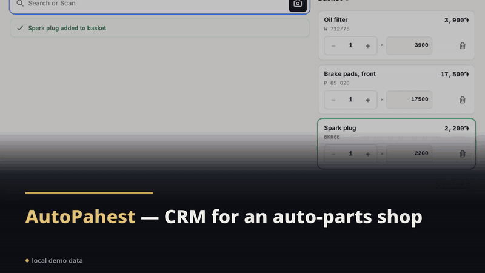
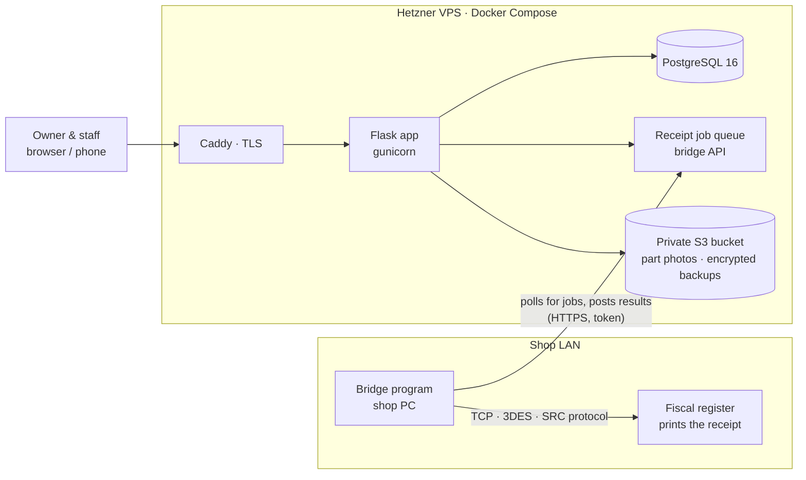
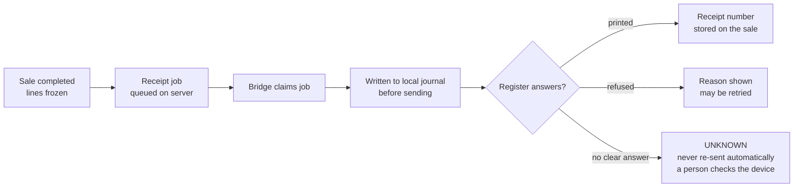
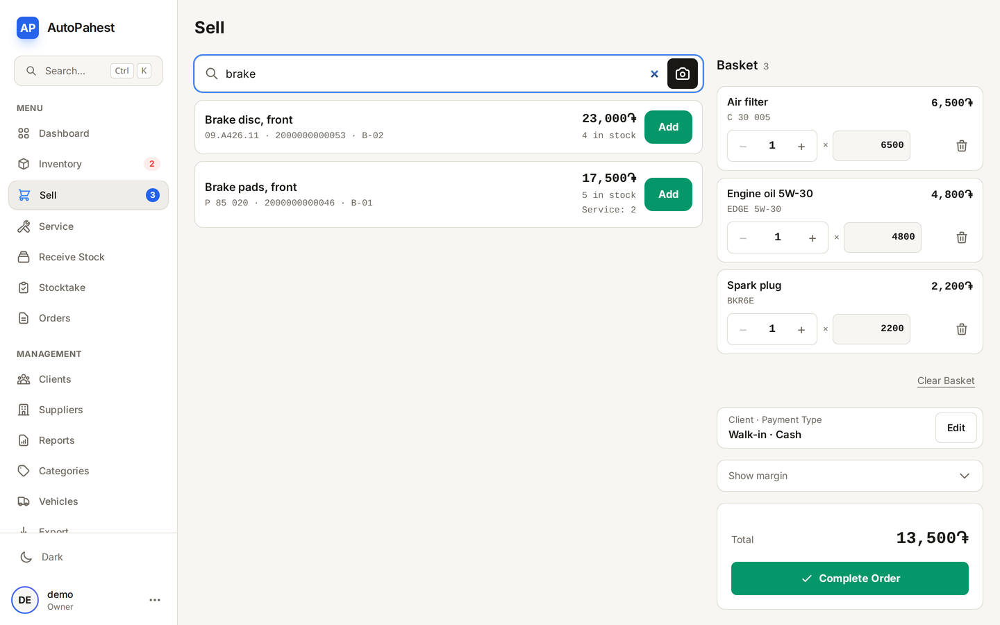
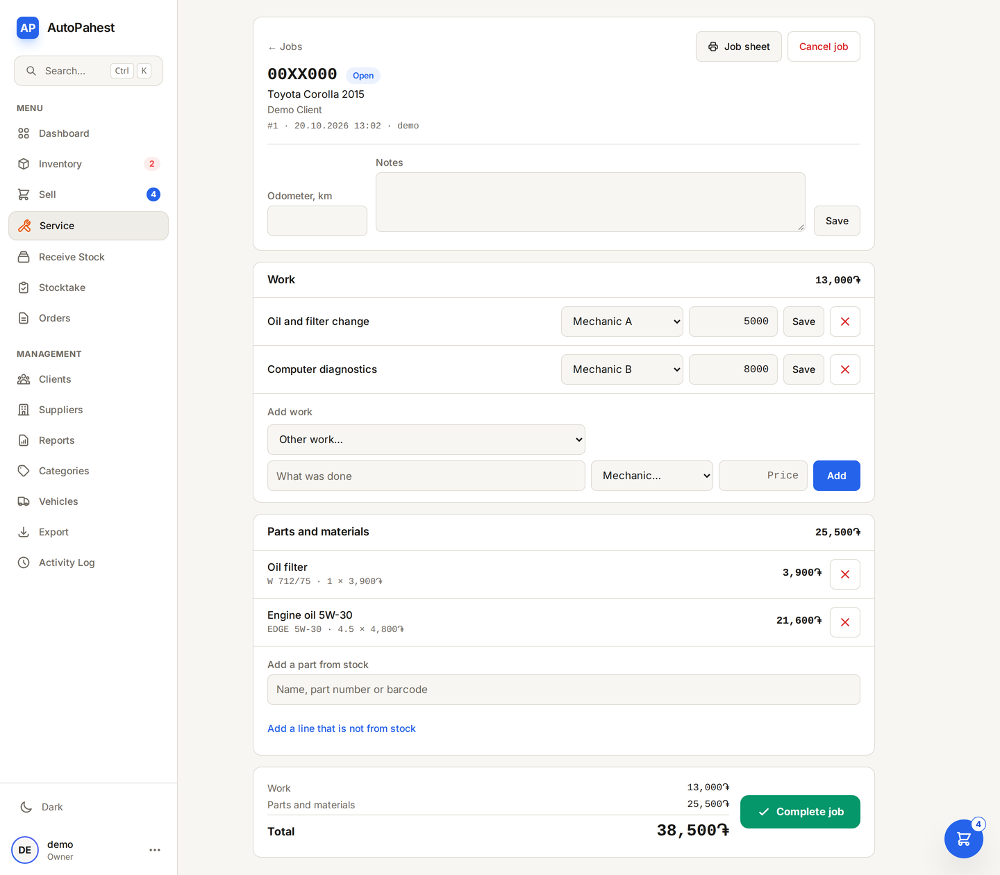
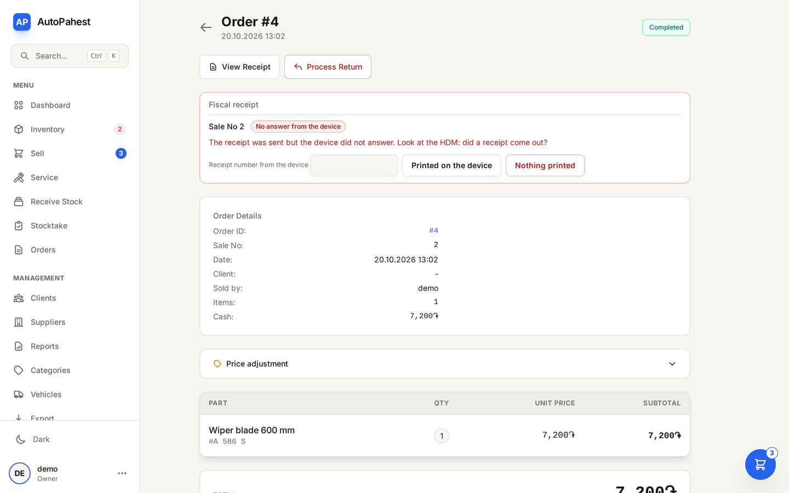
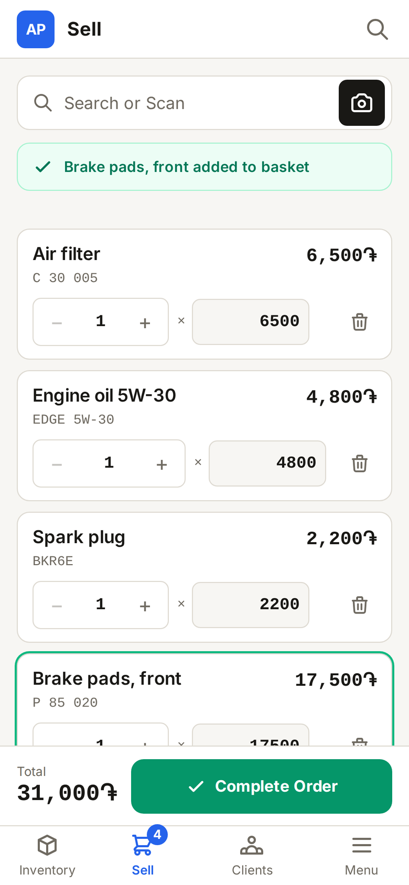

# Auto-parts shop CRM with fiscal receipts — live client system

**Client:** an auto-parts shop with a car service in Armenia · **When:** Feb – Oct 2026 · **Role:** sole engineer, discovery → build → deploy → support

*≈30 s walkthrough · [full-resolution MP4](../media/autoparts/autoparts-flow.mp4) · UI clips recorded on local demo data*

| | |
|---|---|
| **Problem** | An auto-parts shop needed one system for parts, stock, sales, client debts and suppliers, and then for the car service it opened next to the counter. Every counter sale in Armenia also needs a legal receipt from a registered fiscal register (HDM). |
| **Solution** | A server-rendered Flask CRM on one dedicated VPS, in Armenian, Russian and English: a scan-to-basket selling screen, stock per location, job cards for the car service, and a small bridge program on the shop PC that sends each sale to the physical fiscal register over the tax authority's protocol. |
| **Result** | Live and in daily use since **Sep 15, 2026**, with receipts printed from the app on the shop's register. **572 automated tests.** 305 commits, Feb 19 – Oct 19, 2026. |

`Python` · `Flask 3` · `SQLAlchemy 2` · `PostgreSQL 16` · `Alpine.js` · `Tailwind` · `Docker Compose` · `Hetzner`

---

## Problem

The shop sells parts at the counter, often scanning a barcode, sometimes on credit to regular clients. The owner needs to see stock, debts and revenue, and to control what each employee can see and do. In October the shop opened a car service: cars stay for hours, mechanics use parts from the same stock, and they are paid a share of the labour.

Every counter sale also has to produce a fiscal receipt. Without an integration, each sale is entered twice: once in the CRM and once on the register.

## Constraints

- One shop, one owner, a few employees. No ops team; a cheap server.
- Armenian first, plus Russian and English. Every Armenian and Russian string is written or reviewed by the owner.
- **Counter sales need a physical, registered fiscal register.** The law limits the virtual register (e-HDM) to orders placed through a website or app; using one for walk-in sales gets it deregistered.
- The register accepts connections only from one fixed IP on the shop's LAN, so the cloud server cannot talk to it directly.
- What the software sends to the tax authority must equal what is printed, or the Tax Code fines the integrated software.

## Architecture

**A receipt, end to end:**

*The selling screen: search or scan a barcode; each result shows stock at the shop and at the service. Local demo data.*

*A car-service job card: labour lines with the mechanic who did them, parts taken from stock (engine oil in litres). Local demo data.*

*The UNKNOWN case on a sale: the request was sent but the register didn't answer, so the app asks a person to check the device. Produced locally against the register simulator, not the shop's device.*

*The same counter on a phone. Local demo data.*

## Key decisions

**1. One dedicated instance per shop, not a SaaS.**
The first version (Feb – Apr 2026) was built as a product: a Windows desktop build delivered on USB, license keys, Starter/Standard/Pro tiers and multi-tenancy. In September, for the first client, I cut all of it: one cloud instance for one shop, every feature on, no sign-up page, the owner created from the command line so there is no first-run page to hijack. Less code to secure, nothing to upgrade around.

**2. A physical register through a bridge, not a virtual register.**
I researched the law and the tax authority's published integration protocol before writing code. A virtual register can't legally cover counter sales, and the physical one only talks to one IP on the shop LAN. So a small Python program on the shop PC polls the server for receipt jobs and talks to the register (TCP, a 12-byte header, a 3DES-encrypted JSON body, login with session keys and increasing sequence numbers). The server side stays vendor-neutral, so a virtual-register adapter can be added if the rules change.

**3. An unanswered receipt is UNKNOWN, never retried.**
If a receipt request was sent and no clear answer came back, the register may have printed and registered it. Re-sending could register the sale twice. The bridge writes every operation to a local journal *before* sending it, marks an unanswered one UNKNOWN, tells the server, and waits for a person to check the device. Only a job confirmed as not printed, or clearly refused, may be sent again.

**4. Tested against a simulator first, then the real device.**
The bridge was built against an open-source simulator of the register that speaks the real wire protocol, with tests for the header bytes, key derivation and encryption checked against known-answer vectors. On the first run on the shop's real register, all ten operations tried answered successfully, with the client code unchanged from the simulator runs. That run also settled open questions the protocol document left (for example, that report dates are milliseconds).

**5. The receipt must equal the sale, so money and sales had to change first.**
Money moved from floats to exact decimals with one rounding rule. A completed sale is frozen: returns and price adjustments are new documents with their own never-reused numbers, partial returns are allowed by line, and discounts are fixed in the basket before the receipt is printed. The activity log now joins the sale's transaction, so a sale and its log row are saved together or not at all; before, a logging failure could roll back a sale while the screen reported success.

**6. Every stock movement goes through one function.**
Sales, returns, job lines, receiving, transfers and corrections all go through one stock service that locks the part row and updates both the per-location row and the total. A write that leaves them unequal raises. Two people can't both sell the last unit, and the counter can't sell a part that is already on a car in the service.

**7. A job card is not an order.**
The car service has its own tables: a car stays for hours, parts are added as work goes on, and each labour line names a mechanic. A part leaves the shelf when it is added to the job, not when the job is closed. The mechanic's commission is written on the labour line when the job is completed, so changing a rate never rewrites past pay. The counter-sale code stayed untouched.

**Smaller choices:** sessions are signed cookies with a per-user epoch, so one user can be logged out everywhere without Redis; part photos live in a private bucket behind signed URLs; a test fails the build on any user-facing message not wrapped for translation.

## Results

| What | Value | Source |
|---|---|---|
| In production | live since Sep 15, 2026, in daily use; receipts printed from the app | client system |
| Automated tests | **572** (488 app, 84 bridge) | counted in the repo |
| Fiscal register | 10 of 10 operations tried answered successfully on the first run on the real device | protocol notes, Oct 19, 2026 |
| Schema changes | 16 migrations; the stock-location migration was rehearsed on a copy of the production database first | migration folder, deploy notes |
| Backups | nightly, encrypted, off-server; a restore dry run verified | deploy notes |
| Languages | Armenian, Russian, English; translations owner-reviewed, a few newer screens still English | translation catalogs |
| Commits | **305, Feb 19 – Oct 19, 2026** | git history |

I have no measured business numbers yet (time per sale, stock errors before and after).

**What's honestly missing:** the tests run locally before each deploy, not in CI. Error and uptime alerts are ready in code but not switched on in production. Service revenue is not yet joined with the shop's reports.

## What I'd do next

- **Run the test suite in CI** and block deploys on it.
- **Turn on error and uptime alerts.**
- **Shifts and Z-reports** from the app, and reports that match the register's totals.
- **Service money in the shop's reports:** credit jobs, debts and revenue in one dashboard.

## Stack

Python 3 · Flask 3 · SQLAlchemy 2 · Alembic · PostgreSQL 16 · Jinja · Alpine.js · Tailwind · Chart.js · Flask-Babel · Flask-WTF · gunicorn · Caddy · Docker Compose · Hetzner VPS · S3-compatible storage · bridge: Python + `cryptography`

Built by directing AI coding agents (Claude Code); the legal and protocol research, the architecture and the decisions above are mine.
