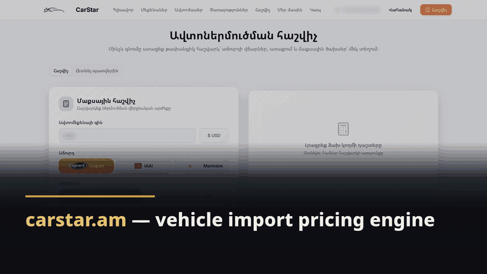
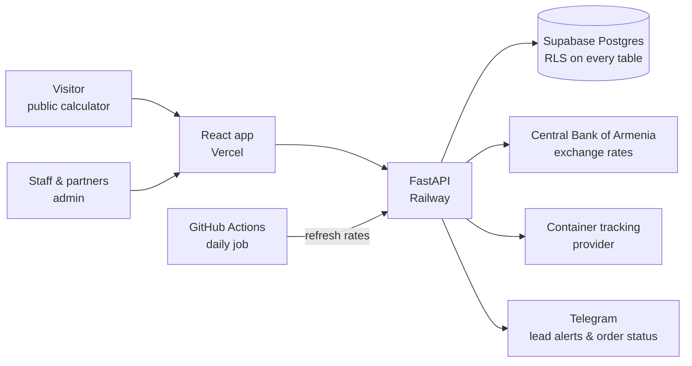
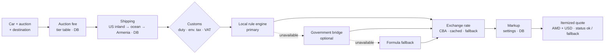
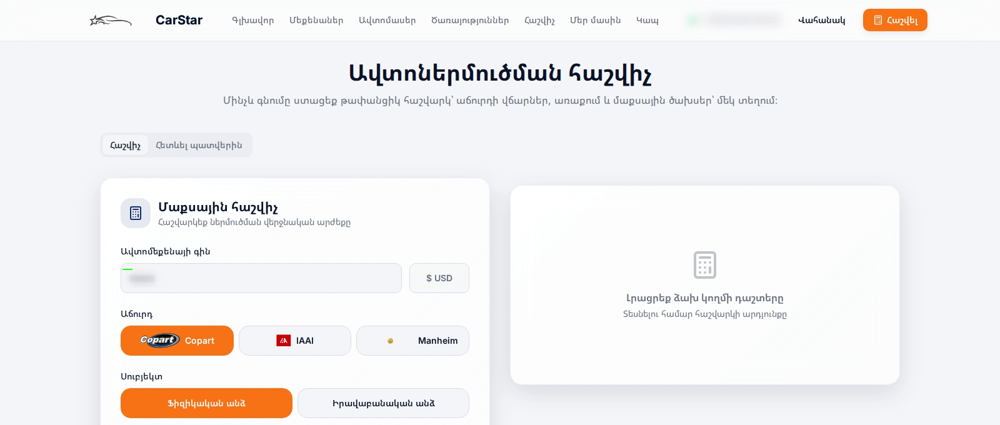

# Vehicle import pricing engine — carstar.am

**Client:** CarStar, Yerevan (named with permission) · **When:** Dec 2025 – Jun 2026 · **Role:** sole engineer, from domain research to deploy and maintenance

*≈30 s walkthrough · [full-resolution MP4](../media/carstar/carstar-flow.mp4) · structure only — the client's rates and rules are not shown*

| | |
|---|---|
| **Problem** | A car-import business quoted customers the landed cost of a US auction car in Armenia by hand: auction fees, three shipping legs, customs duty, environmental tax, VAT and exchange rates. |
| **Solution** | A public calculator and an admin system. The core is a pricing engine I built from Armenia's import tax and customs rules, with Central Bank exchange rates and a fallback at every external dependency. |
| **Result** | One request returns an itemized quote in AMD and USD. Staff change fees, shipping and markup in the admin without a deploy. **860+ commits, Dec 2025 – Jun 2026.** The site at carstar.am is up; the backend is currently offline. |

`React` · `TypeScript` · `FastAPI` · `Supabase (Postgres + RLS)` · `GitHub Actions` · `Vercel` · `Railway`

---

## Problem

Buyers in Armenia pick a car at a US auction (Copart, IAAI, Manheim) and want to know what it will cost delivered. The answer depends on the auction's fee tiers, the US inland leg, the ocean leg, the leg inside Armenia, the car's age, engine type and volume, whether the buyer is a person or a company, and the day's exchange rate.

## Constraints

- The rules come from the EAEU tariff schedule and Armenian practice, not from an API I could trust to always be up.
- Staff must be able to change commercial numbers (fees, shipping, markup) themselves.
- Public calculator traffic must not be able to abuse the backend.
- The client's exact rules and coefficients stay private — this page explains the structure only.

## Architecture

**The pricing pipeline** (one request, `POST /full-calculation`):

*The public site and calculator (Armenian UI; contact details blurred). Captured Oct 2026 while the backend was offline, so no quote is shown.*

## Key decisions

**1. Customs is calculated locally, not by calling the government site.**
The first versions asked the customs authority's online calculator. I rebuilt its logic as a local rule engine — rate tables for each regime, each section annotated with its source and checked against the official calculator — and made the remote call opt-in. A formula fallback sits behind both. Every quote carries a status, so staff can see when a fallback was used. The product no longer depends on a government website being up.

**2. Rules where they change.**
Customs rules change by law, rarely, and need review: they live in versioned code. Auction fees, shipping routes and markup change by business decision, often: they live in the database, editable by staff in the admin.

**3. Exchange rates with three layers.**
Central Bank rates are fetched over its SOAP API, parsed to exact decimals, cached with a time limit, refreshed by a daily scheduled job, and backed by a configured fallback rate if the bank is unreachable.

**4. Paying down the first version.**
The original backend was one ~1,500-line file and the frontend API layer one 1,252-line file. I split the backend into 13 routers (main file now 164 lines) and the API layer into 9 domain modules, and made "pages are orchestration shells" a rule. The v3.0 overhaul touched 81 files.

**5. Cheap, safe auth on every request.**
Supabase JWTs are verified locally instead of calling the auth service per request, then the role is looked up. Row-level security is on for every table, and public endpoints are rate-limited.

**6. A public order tracker that leaks nothing.**
Customers follow their car with an 8-character code from an alphabet without look-alike characters. The public endpoint strips personal data and is rate-limited.

## Results

| What | Value |
|---|---|
| Quote | one request → itemized cost in AMD and USD, with a fallback status |
| Commercial changes | fees, shipping and markup edited by staff, no deploy |
| External dependencies | customs and exchange rates each have a fallback path |
| Codebase health | backend main file 1,500 → 164 lines; API layer split into 9 modules |
| Commits | **860+, Dec 28, 2025 – Jun 5, 2026** (plus migration planning in Aug) |

**What is not measured:** there is no automated test suite for the pricing engine itself. The rule tables were checked against the official calculator, not by automated tests. The 28 backend tests cover tracking, lead de-duplication, notifications and access control, and CI runs lint and build only. That is the biggest gap in this project, and the first thing I'd fix.

## What I'd do next

- **Golden tests for the pricing engine:** a fixture set of real-world cars with officially confirmed customs amounts, run in CI on every change.
- **Run the backend tests in CI**, not just lint.
- **Move to one server** (planned and researched, not executed): Docker Compose and Caddy, run in parallel on staging subdomains before switching DNS, with the current hosting kept live as the rollback.

## Stack

React 18 · TypeScript · Vite · Tailwind · shadcn/ui · Zustand · React Query · FastAPI · PyJWT · slowapi · Supabase (Postgres, RLS, Auth, Storage) · GitHub Actions · Vercel · Railway · Telegram Bot API

The UI started from a Lovable template. Built by directing AI coding agents (Claude Code); the domain research, the pricing design and the decisions above are mine.
