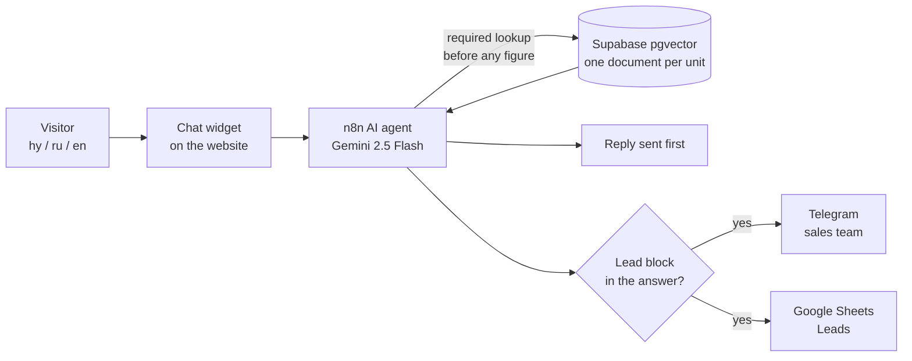
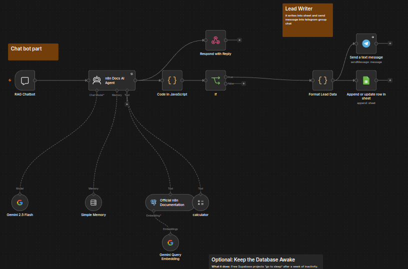
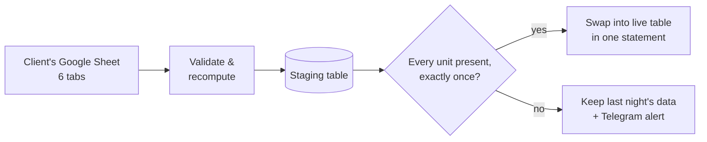
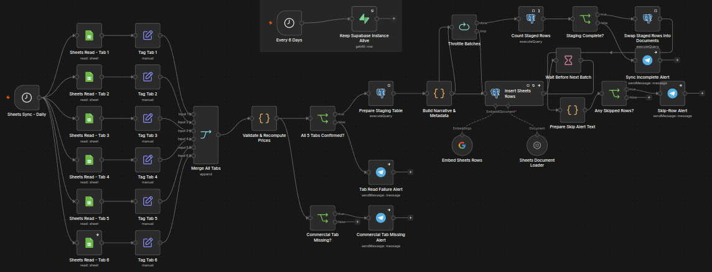
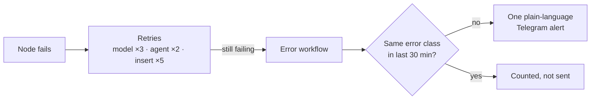
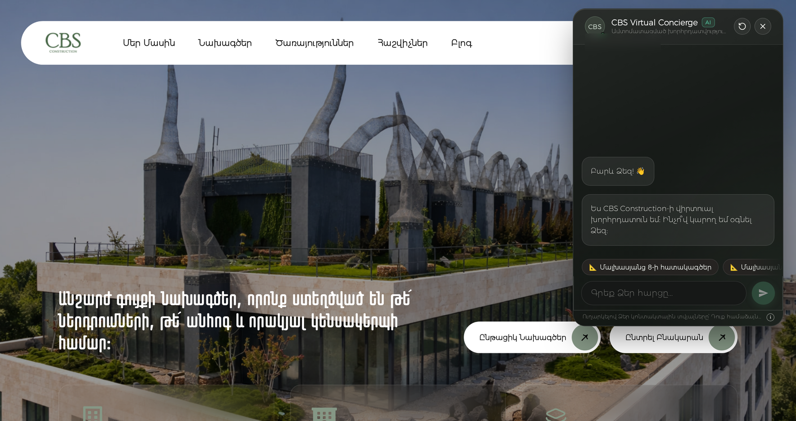
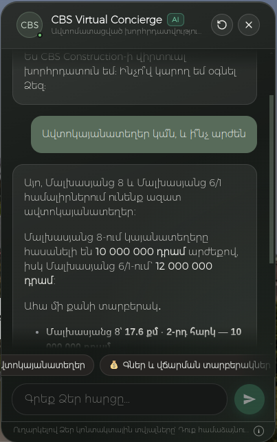
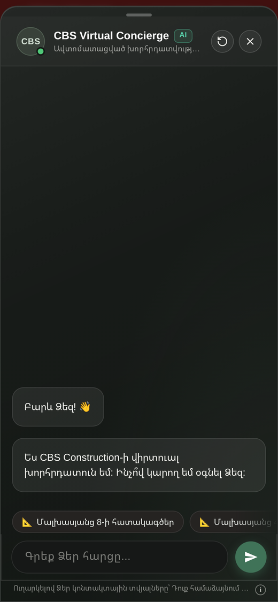

# AI sales assistant for a real-estate developer — CBS Construction

**Client:** CBS Construction, Yerevan (named with permission) · **When:** Jul – Oct 2026 · **Role:** sole engineer, discovery → build → deploy → support

*31 s animated walkthrough · [full-resolution MP4](../media/cbs/cbs-flow.mp4)*

| | |
|---|---|
| **Problem** | Buyers ask the same availability and price questions in Armenian, Russian and English. A chatbot that quotes a wrong price is worse than no chatbot. |
| **Solution** | An n8n AI agent (Gemini) that must look a unit up in a pgvector catalogue before it may quote a figure, answers in the visitor's language, and hands qualified leads to the sales team in Telegram and Google Sheets. |
| **Result** | In the verification rounds: retrieval called **12/12** (was 3/6), **14/14** quoted figures real, **0** invented units (was 3). A failed nightly sync can no longer empty the catalogue. |
| **Status** | Backend live on n8n Cloud. The widget runs on a preview copy of the client's home page on their live site; rollout to the main pages is with the client. |

`n8n` · `LangChain agent nodes` · `Gemini 2.5 Flash` · `Supabase Postgres + pgvector` · `Google Sheets API` · `Telegram Bot API` · `custom JS widget`

---

## Problem

CBS Construction sells apartments, parking and commercial space across three buildings in Yerevan. The catalogue is **397 records** (apartments and parking), maintained by the sales team in a Google Sheet. Most website questions are the same: what is free, what does it cost, how can I pay. They arrive in three languages.

The hard requirement: **never state a price the catalogue does not contain.**

## Constraints

- The client keeps editing the Google Sheet; the bot must pick up changes without me.
- Small budget: n8n Cloud, Supabase free tier, Gemini with a daily request cap.
- The site is WordPress with free Elementor, so the widget has to be a paste-in snippet, not a plugin.
- Three languages, with Armenian the default only when the language cannot be told.

## Architecture

**Chat path**

*The live chat flow in n8n Cloud. Two node names ("n8n Docs AI Agent", "Official n8n Documentation") are leftovers from the starter template; the retrieval tool searches the unit catalogue.*

**Nightly catalogue sync**

*The same sync in n8n: six tab reads → validate → staging → batched insert with waits → count → gate → swap, with a Telegram alert on every failure branch.*

**Failure handling**

*The widget on cbs-construction.am (Armenian UI, client-approved copy). Phone number blurred.*

 &nbsp; 

*Left: a live answer on the client's site to the "Is parking available, and what does it cost?" chip — prices come from the catalogue lookup. Right: the mobile drawer, captured on the widget's demo page.*

## Key decisions

**1. Retrieval is mandatory, not optional.**
In testing, the agent sometimes skipped the catalogue lookup and answered from the prompt alone, inventing three units and a flat per-m² price. Shorter replies made it worse: a first "be brief" prompt cut retrieval to 0/12. The fix was a retrieval contract in the prompt ("brevity never justifies skipping the tool") and a tool description that names the buildings, fields and languages.

**2. Stage, check, then swap — never delete-then-insert.**
The first sync deleted the live table, then re-inserted 397 rows. Any failure mid-loop left the bot with a partial catalogue, and the schedule had failed 3 of its last 4 runs. Now rows load into a staging table, a gate checks completeness, and one SQL statement swaps them in. A failed night keeps the previous night's data.

**3. Count distinct units, not rows.**
The first supervised run staged 418 rows for 397 units: the vector insert is not exactly-once under retries. The gate now compares distinct (building, type, number) keys — the unit number alone repeats 180 distinct values across 397 rows — and the swap de-duplicates. The count node also runs once; before that fix, a failing gate tried to send 397 Telegram alerts.

**4. All-or-nothing batches sized to the quota.**
A mid-batch empty embedding from Gemini later produced duplicates again. Inserts are now one statement per 25-row batch, with a 35 s pause derived from the per-minute quota (it ran out after 73 requests on all seven observed nights).

**5. Reply first, lead second.**
Lead parsing used to block or break the visible reply. The reply is now returned before the lead branch runs.

**6. Language decided per turn.**
English and Russian questions were sometimes answered in Armenian, because the prompt's "default Armenian" rule won every tie and bilingual records pulled replies into Armenian. A per-turn language note fixed it; a smoke test now fails on any Armenian character in an English or Russian reply.

**7. Throttled, classified alerts.**
Alerts are grouped by cause (quota, overload, unknown) with a 30-minute window per class, so a quota outage can't hide a new failure and three failures in a row send one message, not three.

*Also rejected:* Elementor Pro custom code and `functions.php` edits for the widget ("one typo can take the whole site down") — a pasted snippet generated from one source file instead; and my own earlier standalone Node.js prototype, retired in favour of the n8n build.

## Results (measured)

| What | Before | After | How measured |
|---|---|---|---|
| Agent calls the catalogue | 3/6 | **12/12**, then **8/8** | test rounds, Sep 2026 |
| Quoted figures that exist in the catalogue | 3 units invented | **14/14 real** | each figure checked against the database |
| Reply language matches the visitor | 0/6 | **8/8** | follow-up round |
| English/Russian replies containing Armenian script | — | **0 of 24** | after the Oct fix (no baseline run) |
| Reply length | 1,125–1,164 chars | **280–385 chars** | same questions, before/after |
| Live catalogue after sync | 418 rows / 397 units | **397 rows, 397 units, 0 duplicates** | database check after the fixed sync |
| Alerts for 3 consecutive failures | 3 | **1** | measured on the error workflow |

The samples are small test rounds, not production statistics. That is the honest size of the evidence today.

## What I'd do next

- **A standing guard on prices:** an automated check that every figure in a reply exists in the catalogue, instead of manual test rounds.
- **Persistent chat memory** in Postgres (prepared, not yet switched on): memory is in-process today, so a restart drops ongoing conversations.
- **Row-level security** on the Supabase tables (written up, not yet applied): read exposure is low, but an open write path could let someone change a price the bot quotes.

## Stack

n8n Cloud (AI Agent and vector-store nodes) · Google Gemini 2.5 Flash + gemini-embedding-001 · Supabase Postgres + pgvector · Google Sheets API · Telegram Bot API · custom widget over `@n8n/chat`, generated for 3 languages

**190 commits, Jul 20 – Oct 9, 2026.** Built by directing AI coding agents (Claude Code); the architecture, the failure analysis and the decisions above are mine.
