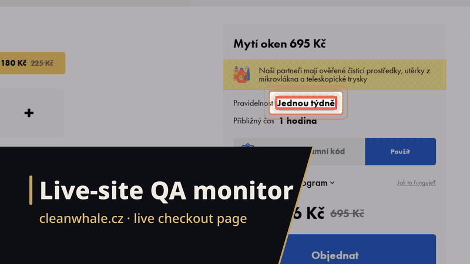
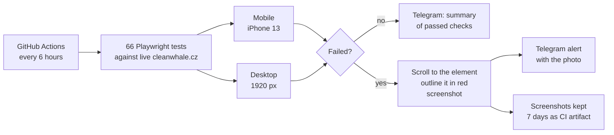
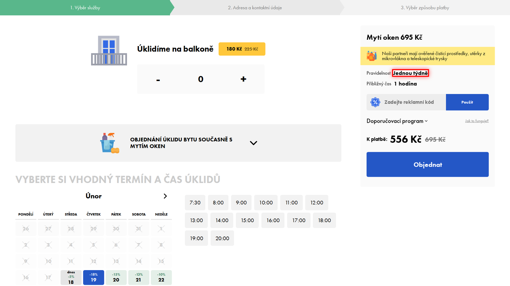
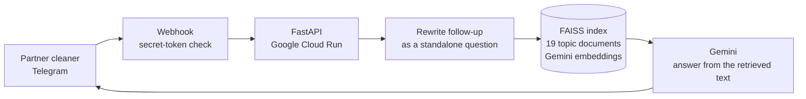

# Live-site QA monitor and staff AI assistant — CleanWhale, Prague

**Client:** CleanWhale, a home-cleaning service company in Prague and Brno (named with permission) · **Role:** Project Development Manager 2023 – 2025, then engineering work for the company · **When:** assistant Jul 2025, QA monitor Feb – Mar 2026

*≈30 s walkthrough · [full-resolution MP4](../media/cleanwhale/cleanwhale-flow.mp4)*

| | |
|---|---|
| **Problem** | Customers book and pay on cleanwhale.cz through calculators and a multi-step checkout, and a broken step costs orders silently. Separately, partner cleaners kept asking questions already answered in internal documentation. |
| **Solution** | **Site guardian:** 66 Playwright tests that run against the live site every 6 hours on mobile and desktop, and send a Telegram alert with a screenshot of the failing element. **Staff assistant:** a Telegram bot on Cloud Run that answers from the company's documentation with Gemini. |
| **Result** | The test suite was calibrated against **5 real bugs on the live site**, each now caught automatically. Failures arrive as a photo with the broken element outlined in red, not as a log line. |

`Playwright` · `pytest` · `GitHub Actions` · `Telegram Bot API` · `FastAPI` · `LangChain` · `FAISS` · `Gemini` · `Google Cloud Run`

---

## 1 · Site guardian (Feb – Mar 2026)

### Problem
The booking flows on cleanwhale.cz — price calculators for each service, then address, then payment — change often. Nobody clicks through every service on a phone after each change, so a broken step can sit unnoticed.

### Architecture

*A real failure capture: after the apartment is removed from the order, the subscription frequency ("Jednou týdně", once a week) should reset, but it doesn't. The guardian outlines the element and sends this picture to Telegram.*

### Key decisions
- **Test the live site, with no mocks.** The point is to catch what a customer would hit today, including content and third-party changes.
- **One test body, two viewports.** Each service's checks are written once and run on both a phone and a desktop viewport, so mobile can't silently fall behind.
- **Calibrate on real bugs.** I tuned the suite until it caught 5 real bugs then present on the site — among them a menu with two active items, a non-Czech call-to-action, a regression in the "experienced supplier" checkbox, and the subscription reset above — so the tests prove they can fail for the right reasons.
- **Alerts a person can act on.** On failure the test scrolls to the element, outlines it in red and attaches the screenshot; if Telegram rejects a tall image it is sent as a document instead. Without credentials the reporter does nothing rather than crash.

### Results
| What | Value |
|---|---|
| Tests | **66** collected (11 page-health checks, navigation, and the handyman, moving, dry-cleaning and windows flows) |
| Schedule | 4 runs a day, Feb 16 – Mar 10, 2026 |
| Real bugs the suite was calibrated on | **5** |
| Runtime | about 5 minutes per run |

The schedule was switched off on Mar 10, 2026.

## 2 · Staff documentation assistant (Jul 2025)

### Problem
Partner cleaners kept asking the same questions — orders, payouts, days off, safety rules, how to clean each room type — although the answers were written down in internal documentation.

### Architecture

### Key decisions
- **Webhook, not polling,** which fits Cloud Run's request-driven model.
- **Every webhook call must carry a secret token** set when the webhook is registered; anything else is rejected. Secrets are mounted from Secret Manager, not baked into the image or env files.
- **`pip-audit` runs in every Cloud Build,** before the image is built.
- **Follow-ups are rewritten into standalone questions** before retrieval, so "and on weekends?" searches for what the person actually means.
- **The system prompt tells the model to ignore attempts to change its instructions.**
- **The documentation was converted to Markdown topic files** (19 of them) so it splits and retrieves cleanly.

This bot grew out of an earlier assistant I built for another client in Jun 2025 (webhook migration, Secret Manager, lead form instead of scraping contact details from chat), generalised for CleanWhale.

### What's honestly missing
- **Conversation memory is shared, not per user,** and unbounded. A per-user memory in Redis with a 3-day expiry was prototyped but never deployed.
- **No evaluation set.** There is no measured answer accuracy.

## What I'd do next
- Per-user, time-limited conversation memory (finish the Redis version).
- A small evaluation set of real staff questions with expected answers, run before each prompt or document change.
- Bring the guardian back on a schedule and point it at the current version of the site.

## Stack
**Guardian:** Python 3.11 · pytest · Playwright (Chromium) · GitHub Actions · python-telegram-bot
**Assistant:** Python · FastAPI · python-telegram-bot · LangChain · FAISS · Gemini (chat and embeddings) · Docker · Google Cloud Build · Cloud Run · Secret Manager

Built by directing AI coding agents; the architecture and decisions are mine.
