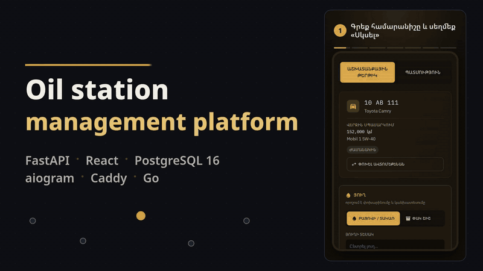
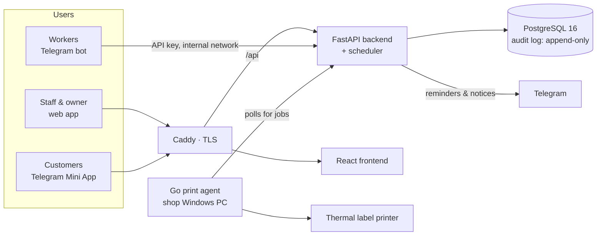
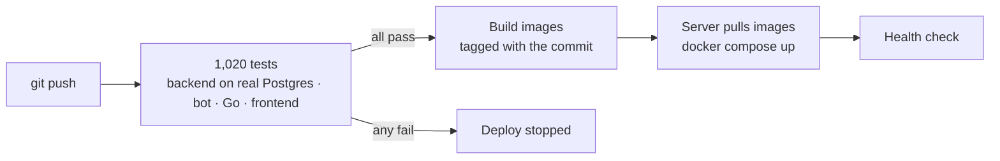
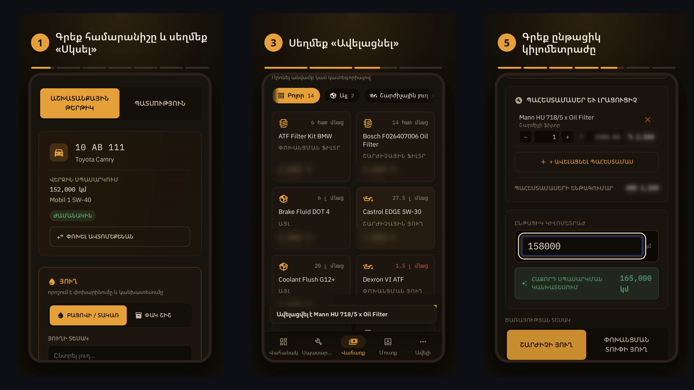
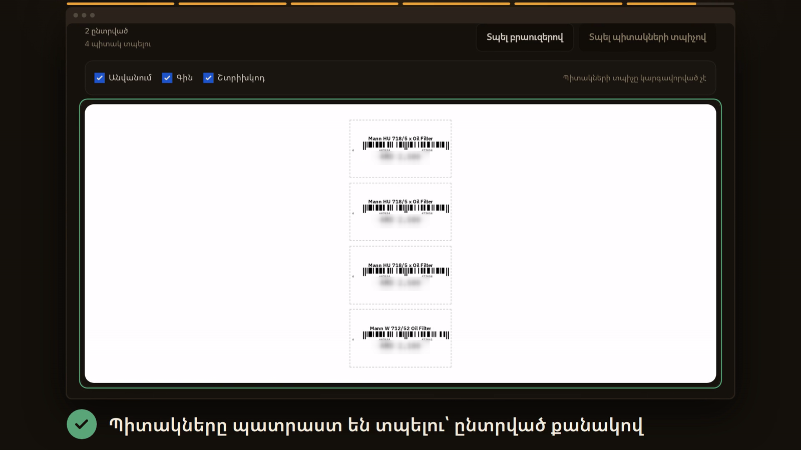
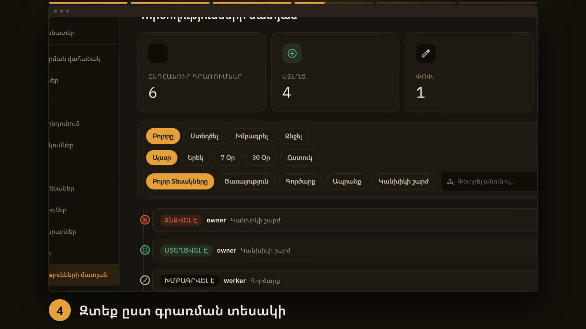

# Management platform for an oil-change station — Har Oil

**Client:** Har Oil, an oil-change and auto-service station in Armenia · **When:** Apr – Oct 2026 · **Role:** sole engineer, discovery → build → deploy → support

*≈30 s walkthrough · [full-resolution MP4](../media/oil/oil-flow.mp4) · UI clips recorded on demo data*

| | |
|---|---|
| **Problem** | The station needed one system for stock, services, sales, cash and customer debts, with controlled staff access, in Armenian, that workers would actually use during a shift. |
| **Solution** | A web app for the counter and the owner, a Telegram bot for workers, a Telegram Mini App for customers, and a Windows print agent for shelf labels — five Docker services behind Caddy, with an audit log the database itself protects. |
| **Result** | Live and in daily use at the station. **1,020 automated tests** run on every push, and a single failure blocks the deploy. 992 commits, Apr – Oct 2026. |

`FastAPI` · `PostgreSQL 16` · `React 19` · `aiogram 3` · `Caddy` · `Go` · `Docker Compose` · `GitHub Actions`

---

## Problem

One station, its workers and its owner. The work happens at the car, not at a desk: a worker changes the oil, takes parts from stock, and the customer pays now or later. The owner needs to see stock, cash, debts and profit, and to know who changed what.

The design target, written down at the start: *a worker must be able to record a completed service in the Telegram bot in under 60 seconds, with stock updating automatically.*

## Constraints

- Armenian first; English and Russian for some staff and customers.
- Workers must not see debt data, and can only edit entries for a short time.
- Labels print on a thermal printer attached to the shop's Windows PC, which has to keep working as a normal printer.
- One small server, no ops team: deploys and rollbacks have to be boring.

## Architecture

**Auth lanes, one backend:** cookie session (JWT, httpOnly) for the web app with role checks per endpoint; an API key for the bot; Telegram-signed init data for the Mini App; a separate key for the print agent. The backend refuses to start if any secret is missing, weak or a placeholder.

**Deploy:**

*The worker flow on a phone: find the car by plate, add parts, enter the mileage; the next service is suggested automatically. Armenian UI, demo data, prices blurred.*

*Shelf labels rendered by the backend and sent to the shop's printer through the Go agent (prices blurred).*

*The owner's activity log, filterable by action, period and section. Every entry is backed by the append-only audit table.*

## Key decisions

**1. A custom print agent instead of WebUSB or QZ Tray.**
WebUSB on Windows needs the printer's driver swapped for WinUSB, which breaks normal printing and is fragile on a client machine. A small Go agent on the shop PC polls the backend for label jobs and writes raw printer commands to the Windows spooler. The backend renders the label, including Armenian text as a bitmap. The printer and its driver stay untouched.

**2. The audit log is protected by the database, not by the app.**
Every change is written with its before/after state. Database triggers refuse UPDATE, DELETE and TRUNCATE on the audit table, and the timestamp is set by the database. A bug or a compromised app account can't rewrite history. (The table owner could still drop the triggers; that limit is documented.)

**3. Balances are computed, never stored.**
Debts and supplier balances are the amount minus settlements, from a single transactions ledger. There is no stored balance to drift out of sync.

**4. Build once in CI, pull on the server.**
Images are built in GitHub Actions and tagged with the commit; the server only pulls and restarts. Rollback means deploying an earlier commit's images. No building on the server, no copying files by hand. Lockfiles are pinned after an unpinned dependency once pulled in a breaking upgrade between two builds.

**5. Tests run against real PostgreSQL.**
No mocked database: the backend suite runs against a real Postgres service in CI, so migrations, constraints and triggers are tested as they run in production.

**6. Moved off a managed platform.**
The first deploys ran on Railway. The system now runs on one self-managed server with Docker Compose and Caddy, so the whole stack is described in one compose file and deployed the same way every time.

**Smaller choices:** worker edits allowed only within a rolling window (4 h by default); stock can never go negative; clean, translated error messages instead of raw 500s in the bot and the API.

## Results

| What | Value | Source |
|---|---|---|
| In production | live, in daily use at the station | client system |
| Automated tests | **1,020** (599 backend, 41 bot, 13 Go, 367 frontend) | counted in the repo |
| Deploys gated by tests | every push; one failure stops the deploy | CI workflow |
| Services | 5 containers + a Windows print agent | compose file |
| Languages | Armenian, English, Russian | locale files |
| Schema changes | 32 migrations, applied automatically on start | migration folder |
| Commits | **992, Apr 12 – Oct 13, 2026** | git history |

I have no measured business numbers yet (time per service, stock errors before and after). The 60-second target above is a design goal, not a measurement.

## What I'd do next

- **Measure the 60-second target** from real timestamps in the bot flow, instead of stating it as a goal.
- **Restrict the database role** so the application account cannot drop the audit triggers.
- **Automated, tested restores** of database backups, not just backups.

## Stack

Python 3.11 · FastAPI · SQLAlchemy 2 · Alembic · APScheduler · PostgreSQL 16 · React 19 · Vite · Tailwind · react-i18next · aiogram 3 · Go (print agent) · Caddy · Docker Compose · GitHub Actions → GHCR → VPS

Built by directing AI coding agents (Claude Code); the architecture, the decisions above and the client work are mine.
